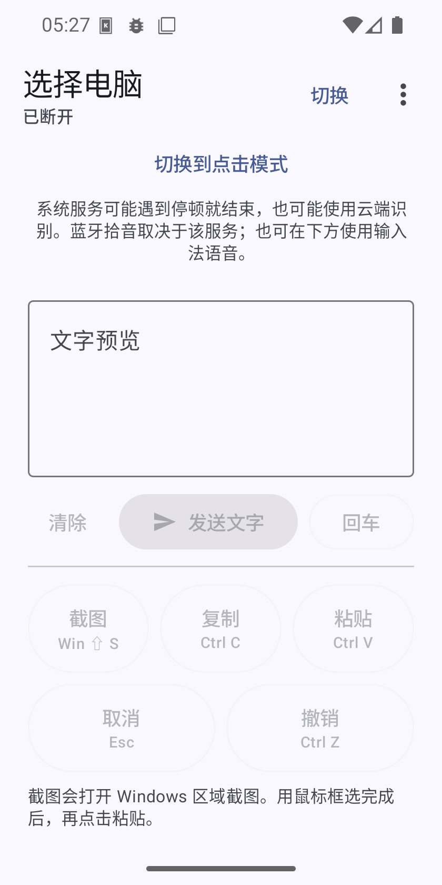

# KDE Connect Lite Remote

基于 KDE Connect Android 的极简语音输入与 Windows 快捷控制界面。手机负责识别、编辑和发送文字，Windows 继续使用官方 KDE Connect，电脑上的 Cursor、Codex 等应用接收当前焦点输入。原有设备发现、配对、加密连接和远程输入插件继续复用。

项目目录：`D:\Apps\Tools\KDEConnect\android`；开发分支：`feature/vibe-lite-remote`；个人 Fork：[Lisuiwen/kdeconnect-android](https://github.com/Lisuiwen/kdeconnect-android)。

## 安装与首次连接

1. 构建并安装 Debug APK，测试包名为 `org.kde.kdeconnect_tp.debug`。它与正式版 `org.kde.kdeconnect_tp` 使用独立应用数据，可以并行安装；无需卸载正式版。
2. 手机和 Brook 连接同一可互通网络，保持 Windows 官方 KDE Connect 运行。
3. 打开测试版，进入右上角菜单中的“完整 KDE Connect”或“管理 / 配对设备”，重新与 Brook 配对。正式版已有的配对不会自动迁移。
4. 在电脑端允许远程输入，并确认手机端顶部显示“Brook · 已连接”。已连接但输入插件不可用时，页面会提示检查电脑端设置。
5. 若找不到设备，使用“刷新连接”，或回到完整 KDE Connect 检查发现、配对及网络权限。

极简页默认记住上次选择的已配对电脑；首次选择时优先名称为 Brook 的电脑，然后考虑连接状态。设备 ID 不写死。点“切换”可以更换目标，只列出已配对的台式机和笔记本；设备管理与新配对仍在完整界面完成。

测试版只有一个桌面启动入口，默认打开极简首页。右上角菜单可以改为默认打开完整 KDE Connect；完整界面的菜单也可以再次进入“极简遥控”。完整功能入口始终保留。

启动入口使用独立的无界面路由 Activity，每次点图标都会读取默认首页设置。最近任务仍恢复上次页面，完整界面与极简页也可以直接互切。

## 语音与文字

1. 首次操作话筒时授予麦克风权限。授权完成后再次操作话筒，避免权限弹窗关闭后意外开始录音。
2. 默认“按住说话”：按下调用系统 `SpeechRecognizer.startListening()`，松开调用 `stopListening()`，等待最终结果。
3. 若当前识别服务不适合长按，切换为“点击开始 / 再次点击结束”。两种模式都显示准备、聆听、处理或错误状态，并显示录音时长。
4. 最终结果追加到“文字预览”，多段之间换行。已有内容可以编辑、清空，也可以直接通过手机输入法打字或使用输入法自己的话筒。
5. 在电脑上用鼠标将焦点放到目标输入框，再点击“发送文字”。发送文字不会自动附带回车；确认内容后，需要提交时再单独点旁边的“回车”。两个按钮保持独立，回车在草稿为空时也可操作。

“已加入发送队列”只表示本地交给 KDE Connect 发送接口，不能证明电脑或目标应用已收到。发送后草稿仍保留，便于断线恢复和核对；重复点击发送可能重复输入。

断线时发送文字和快捷键会被禁用，编辑和手机语音识别仍可使用。草稿按目标设备保存在本机应用数据中，切换设备、页面重建或离线不会清空；不再需要的草稿可用“清空”删除。离开页面、切换语音模式或切换设备会取消尚未完成的识别，已确认的草稿保留。

### 系统识别与蓝牙限制

- 本页使用系统提供的识别服务和系统默认语言，不额外调用大模型 API，也不保存原始录音。系统识别服务可能把声音发送到其自身的云端；隐私行为取决于该服务。
- 服务可以因停顿或自身时长限制提前结束识别，持续按住不能保证无限录音。没有服务、权限不足、网络错误、空结果及语言模型缺失等情形会显示错误，已有草稿不变。
- 系统原生识别与输入法语音可能使用不同引擎。系统服务不可用时，可在“文字预览”中使用输入法语音。
- 蓝牙已连接不能证明识别服务正在使用耳机麦克风。此版本不强制改变音频路由，断开耳机后的回退由系统服务处理；必须按下文步骤验证实际拾音来源。
- 服务准备超过 15 秒或停止后等待最终结果超过 30 秒，会结束该次请求并提示重试。

系统接口行为参考 Android 官方 [SpeechRecognizer 文档](https://developer.android.com/reference/android/speech/SpeechRecognizer)，具体识别能力仍以手机所安装的服务为准。

## Windows 快捷操作

| 按钮 | 发送按键 | 用途 |
| --- | --- | --- |
| 截图 | `Win + Shift + S` | 打开 Windows 系统区域截图 |
| 复制 | `Ctrl + C` | 复制当前选中内容 |
| 粘贴 | `Ctrl + V` | 向电脑当前焦点窗口粘贴 |
| 回车 | `Enter` | 由用户单独确认提交或换行 |
| 取消 | `Esc` | 取消电脑当前操作 |
| 撤销 | `Ctrl + Z` | 撤销电脑当前编辑 |

所有按钮通过现有 MousePad 协议独立发送，实际效果取决于电脑当前焦点应用。截图流程为：手机点“截图” → 电脑上用鼠标框选 → 将焦点放回支持图片的输入框 → 手机点“粘贴”。不会自动衔接截图与粘贴，也不把截图传回手机。

Lite 界面不主动写入手机或电脑剪贴板。发送文字使用 `MousePadPlugin.sendText()`，快捷键发送键盘事件；截图后的图片应继续保存在 Windows 剪贴板中。原版 KDE Connect 的剪贴板同步功能及其他应用仍可能影响剪贴板，因此需要完成图片粘贴专项真机验证。

## 本地开发与构建

使用项目已有的 JDK 21、Gradle Wrapper 9.6.0 和 `compileSdk = 37`。本地 SDK 放在 `D:\Apps\Tools\KDEConnect\toolchain\android-sdk`；`local.properties` 为本机配置，不提交到 Git。没有为 Lite 功能改动上游 Gradle、Android 插件或 SDK 版本。

PowerShell 中进入项目目录后执行：

```powershell
Set-Location 'D:\Apps\Tools\KDEConnect\android'
.\gradlew.bat assembleDebug --console=plain
.\gradlew.bat testDebugUnitTest --tests 'org.kde.kdeconnect.ui.lite.*' --console=plain
```

若本机已运行 `127.0.0.1:7897` 代理且依赖下载需要它，可仅为本次 Gradle 进程指定代理，不修改系统全局代理：

```powershell
.\gradlew.bat '-Dhttps.proxyHost=127.0.0.1' '-Dhttps.proxyPort=7897' '-Dhttp.proxyHost=127.0.0.1' '-Dhttp.proxyPort=7897' assembleDebug --console=plain
```

APK 生成后先检查实际文件名：

```powershell
Get-ChildItem '.\build\outputs\apk\debug\*.apk'
$liteAdb = 'D:\Apps\Tools\KDEConnect\toolchain\android-sdk\platform-tools\adb.exe'
& $liteAdb devices -l
# 将下行 APK 路径替换为上一条命令实际列出的文件；多设备时加 -s 序列号。
& $liteAdb install -r '.\build\outputs\apk\debug\kdeconnect-android-debug.apk'
& $liteAdb shell am start -n 'org.kde.kdeconnect_tp.debug/org.kde.kdeconnect.ui.lite.LiteRemoteActivity'
```

`install -r` 更新同一测试包，首次安装也可使用。确认包名为 `.debug`，不卸载、不覆盖正式版。USB/ADB 用于构建部署和调试，手机与电脑间的远程输入仍经 KDE Connect 连接传输。

## 修改范围

| 类型 | 文件或目录 | 改动 |
| --- | --- | --- |
| 修改上游文件 | `src/main/AndroidManifest.xml` | 注册极简启动 Activity，保留完整 Activity，增加系统语音服务可见性声明 |
| 修改上游文件 | `src/main/java/org/kde/kdeconnect/ui/MainActivity.kt` | 增加进入极简遥控的菜单入口 |
| 修改上游文件 | `build.gradle.kts` | 许可证报告解析 Debug / Release 运行时依赖及 `coreLibraryDesugaring`，包含传递依赖和随 APK 分发的 OpenJDK 脱糖运行库声明，避免下载无关的 AGP、Lint 和测试工具 |
| 新增模块 | `src/main/java/org/kde/kdeconnect/ui/lite/` | 启动路由、极简 Activity、Compose 页面、设备与草稿状态、语音控制器、快捷键控制器 |
| 新增资源 | `src/main/res/values/lite_remote_strings.xml`、`src/main/res/values-zh-rCN/lite_remote_strings.xml` | 英文与简体中文界面文本 |
| 新增测试 | `src/test/java/org/kde/kdeconnect/ui/lite/` | 6 个 ViewModel、6 个快捷键、8 个语音控制测试，共 20 个 |
| 文档 | `README.md`、`docs/LITE_REMOTE.md` | 使用入口、构建方法及验收记录 |

不改动 Windows 安装、不增加网络协议或未鉴权服务。许可沿用 KDE Connect 的 GPL 声明，保留上游源码许可与版权信息。

## 验收记录与人工步骤

2026-10-25（北京时间）验证结果：`assembleDebug` 成功，Lite 定向单元测试 **20 / 20 通过**，无失败、错误或跳过。覆盖草稿隔离及恢复、离线保护、不自动回车、六种快捷键协议字段、语音取消/时序/超时和资源释放。这些测试没有调用手机上的真实语音引擎，也没有向真实 Windows 窗口输入。

APK：`build/outputs/apk/debug/kdeconnect-android-debug.apk`，27,684,545 字节。包名 `org.kde.kdeconnect_tp.debug`，启动入口为 `LiteRemoteLauncherActivity`，按设置进入极简页或完整界面；`apksigner` 验证通过（v1 / v2），目标 SDK 37。已解包核对 `res/raw/license` 与生成文件一致，并包含 NIO 2.1.5 运行库及 GPL Classpath Exception 声明。

SHA256：`2C154295D5979F7A79D3327E47388FDF4184B169B8E2C71A2A488B1596EF5D31`。

已在 Xiaomi 14、Android 16 / API 36 上成功安装测试版，手机与 Brook 已配对且可访问，真机极简页显示已连接。系统识别服务为 `com.xiaomi.mibrain.speech/.asr.AsrService`；用户确认预览中的“你好”来自按住话筒识别，并反馈实际试用可以正常使用。各快捷键、Cursor 不自动提交和图片剪贴板仍按下表逐项记录，不能把整体试用反馈作为所有项目均已验收的证据。

本次仅安装 / 更新 `org.kde.kdeconnect_tp.debug`，未执行正式包卸载命令，Windows 安装未改动。独立包名已经核验；当前手机的正式包并存情况尚未完成验证。

随后已在独立 Android 16 中文模拟器 `KDEConnect_Lite_API_36`（`emulator-5554`）安装更新版。实际检查了竖屏、横屏滚动、软键盘、深浅色、草稿旋转/强制重启恢复、完整界面往返、默认首页开关的冷/热启动、拒绝麦克风权限和无语音结果提示，未发现应用崩溃。预览期间修复了旧麦克风权限提示残留，以及启动图标直接恢复任务导致默认首页设置无法应用的问题；修改后重新构建，20 项单元测试再次通过。

模拟器使用 WHPX 硬件加速和软件 GPU。37.2.12 的 netsimd 在本机初始化失败，启动时关闭 `WiFiPacketStream`、`BluetoothEmulation`、`Uwb`、`Nfc` 后可正常运行，Wi-Fi 使用原有网络栈。本次关闭宿主音频，仅用于界面预览；语音识别返回的是“未识别到语音”，不能据此判定中文识别或蓝牙拾音通过。模拟器未与 Brook 配对，发送和快捷键禁用符合预期。

按用户真机试用后的反馈，已将独立“回车”移到“发送文字”右侧，并从下方快捷区移除重复入口。仅调整布局，发送与回车的协议和启用条件保持独立；重新构建成功并已更新手机测试版。在 320dp 窄屏模拟器上核对两个按钮并排、无截断；本次布局调整未新增或重跑逻辑单元测试。



本地详细记录位于 `build/qa/verification.json`，测试报告位于 `build/reports/tests/testDebugUnitTest/index.html`；这些生成文件不提交 Git。以下保留各项真实验收进度与人工步骤。

| 编号 | 场景 | 当前结果 | 人工验证步骤 / 通过条件 |
| --- | --- | --- | --- |
| AC-01 | 极简首页 | 真机已启动显示；模拟器深浅色、旋转和软键盘已检查 | 从测试版图标启动，确认单页、话筒、编辑框、发送旁的回车和下方五个快捷键；真机主题、横屏及键盘适配待专项检查 |
| AC-02 | 连接 Brook | 真机已配对且可访问，顶部已连接；设备选择及离线保护单测通过 | 关闭电脑端远程输入，补测明确提示且禁用发送 |
| AC-03 | 中文语音 | 用户确认真机长按识别得到“你好”；模拟器拒权/无语音路径通过 | 补测长句和点击模式，说“帮我检查这个组件的布局”，核对最终预览；空识别不清空旧稿 |
| AC-04 | 中英混合术语 | 待真人说话验证 | 说“在 Android 的 LiteRemoteActivity 中检查 Kotlin StateFlow 和 Cursor 输入”，记录引擎、语言、结果和具体误词 |
| AC-05 | 蓝牙拾音 | 待真人对照验证 | 按下文“蓝牙对照”操作，记录真实拾音来源及断开后的恢复情况 |
| AC-06 | Cursor 焦点输入 | 用户反馈整体试用可用；不附带 Enter 的单测通过，待逐项记录 Cursor 验证 | 鼠标点进 Cursor 输入框，发送可辨认测试句；逐字核对收到内容，确认没有自动提交，再单独点旁边的回车 |
| AC-07 | 区域截图 | 热键协议单测通过，待 Windows 验证 | 手机点截图，确认 Windows 出现区域选择界面，使用电脑鼠标框选；也验证 Esc 能取消 |
| AC-08 | 截图后粘贴图片 | 待 Windows 端到端验证 | 完成截图后聚焦支持图片的 Cursor 输入框，再点粘贴；应出现图片附件，不能被手机草稿文本覆盖 |
| AC-09 | 复制、粘贴、回车、Esc、撤销 | 协议字段及禁用保护单测通过，待 Windows 验证 | 在可丢弃的编辑内容中分别选中文本复制、粘贴、换行、关闭菜单、撤销；每个按钮只执行一次对应操作 |
| AC-10 | 断线与重建 | 单测通过，模拟器旋转/强制重启恢复通过，待实机断线测试 | 编辑草稿后暂断 Wi-Fi，确认禁用发送且草稿不变；恢复网络、旋转屏幕和重开测试版，核对设备选择及草稿恢复 |
| AC-11 | 完整 KDE 功能 | 模拟器页面往返及默认首页冷/热启动通过，其他功能待真机 | 极简菜单进入完整界面，检查设备、插件和设置，再从完整菜单返回极简；切换默认首页后重新启动 |
| AC-12 | 并行安装 | 测试版真机安装成功，独立包名和签名已核验；正式版实际并存待核对 | 检查正式包与 `.debug` 同时存在，各自可启动、配对数据独立；确认正式版仍正常 |

### 蓝牙对照

1. 先不用耳机，记录一段中文与混合术语的识别表现。
2. 连接待测耳机，将手机放到数米外，用正常音量只对耳机麦克风说话；再靠近手机、远离耳机说另一句可区分内容。观察两次识别表现，不能只凭蓝牙图标判断。
3. 如有可靠的系统音频诊断，记录识别期间实际录音路由；否则把拾音来源标记为“未确认”，不要写成已通过耳机麦克风验收。
4. 识别中断开耳机，观察错误或系统回退；结束后再说话，确认可重试、无崩溃、旧草稿保留。

### 异常补测

- 在系统设置中拒绝或撤销麦克风权限，再操作话筒，确认出现授权提示，输入法或手动文字仍可使用。
- 在缺少系统识别服务的设备上，确认明确提示，并可通过预览框使用输入法语音。
- 识别过程中切换到完整 KDE Connect 或后台，确认停止录音；返回后重试，已完成草稿保留。
- 在电脑截图后先仅编辑手机预览，不点击复制，再到电脑粘贴，确认图片剪贴板仍在。将此结果与 AC-08 一并记录。

最终验收应附：APK 文件名和哈希、构建/测试结果、手机型号及 Android 版本、系统识别服务、Windows 焦点应用、各 AC 结果、未完成项与具体复现步骤。
